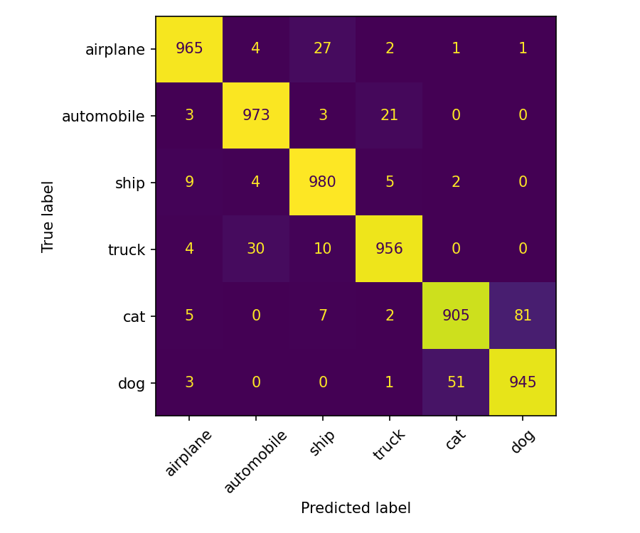
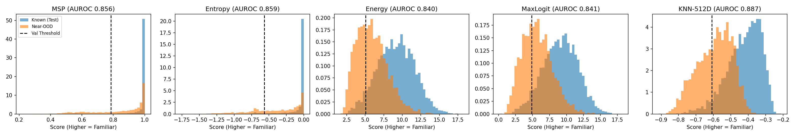
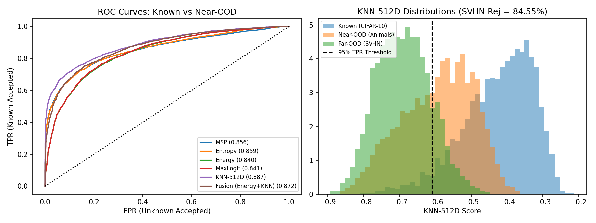
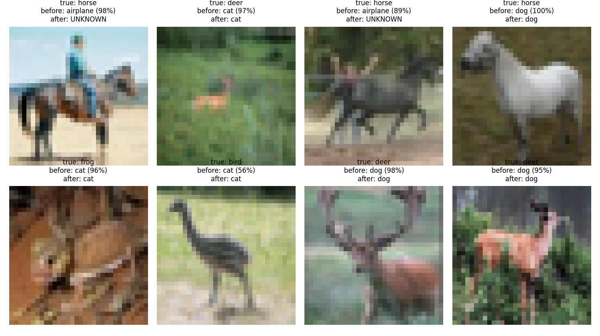
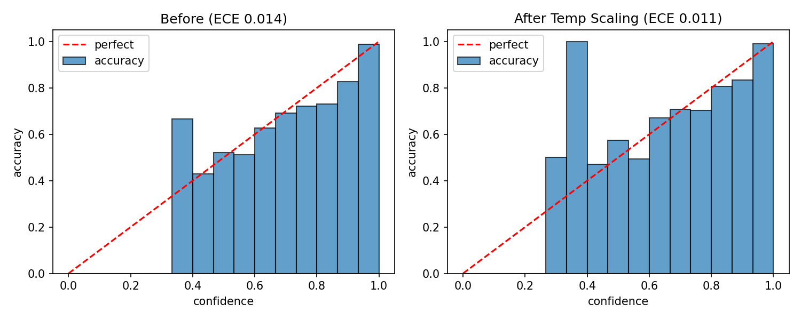
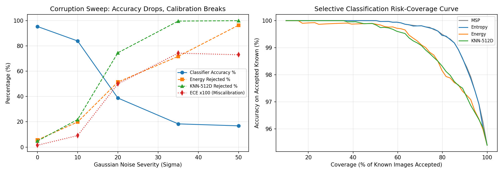

# The Model That Doesn't Know

An image classification and Out-of-Distribution (OOD) detection system that recognizes familiar categories while actively rejecting uncertain, unfamiliar, or degraded inputs as `UNKNOWN`.

---

## 1. Problem Statement

Standard deep neural networks operate under a closed-world assumption: the final Softmax layer forces class probabilities to sum to `1.0` (100%), even when fed unfamiliar categories or corrupted images[cite: 1]. In real-world deployments, a confident wrong prediction can be far more costly than abstaining[cite: 1].

This project fine-tunes a classifier on 6 known classes and benchmarks **6 uncertainty estimation methods across three families**—Logit-Space (`MSP`, `Entropy`, `Energy`, `MaxLogit`), Penultimate Feature-Space (`KNN-512D`), and Hybrid Detector Fusion (`Energy + KNN-512D`)—evaluated across **Near-OOD**, **Far-OOD**, and **Corrupted/Noisy** image regimes.

---

## 2. Dataset & Partitioning# The Model That Doesn't Know

An image classification and Out-of-Distribution (OOD) detection system that recognizes familiar categories while actively rejecting uncertain, unfamiliar, or degraded inputs as `UNKNOWN`.

---

## 1. Problem Statement

Standard deep neural networks operate under a closed-world assumption: the final Softmax layer forces class probabilities to sum to `1.0` (100%), even when fed unfamiliar categories or corrupted images[cite: 1]. In real-world deployments, a confident wrong prediction can be far more costly than abstaining[cite: 1].

This project fine-tunes a classifier on 6 known classes and benchmarks **6 uncertainty estimation methods across three families**—Logit-Space (`MSP`, `Entropy`, `Energy`, `MaxLogit`), Penultimate Feature-Space (`KNN-512D`), and Hybrid Detector Fusion (`Energy + KNN-512D`)—evaluated across **Near-OOD**, **Far-OOD**, and **Corrupted/Noisy** image regimes.

---

## 2. Dataset & Partitioning

We partition **CIFAR-10** (60,000 color images, `32x32`) into a closed-set training environment and an open-set evaluation environment[cite: 1], supplemented by an external **Far-OOD** benchmark and a synthetic noise sanity check:

- **Known Classes (6):** `airplane`, `automobile`, `ship`, `truck`, `cat`, `dog`[cite: 1]
- **Near-OOD Unknown Classes (4):** `bird`, `deer`, `frog`, `horse` *(excluded from training; shares dataset statistics and semantic features with known classes, e.g., `deer`/`horse` vs. `cat`/`dog`, `bird` vs. `airplane`)*[cite: 1]
- **Far-OOD Benchmark:** **SVHN (Street View House Numbers)** — 4,000 cropped street digit images testing domain-shifted non-object geometry.
- **Sanity Check OOD:** **Uniform Random Noise** — 2,000 synthetic random pixel tensors verifying baseline statistical anomaly rejection.

| Split | Categories | Image Count | Purpose |
|---|---|---|---|
| **Train** | 6 Known | 27,000 | Fine-tuning ResNet18 & indexing the 512-D KNN feature bank (5,000 subset)[cite: 1] |
| **Validation** | 6 Known | 3,000 | Picking the 95% TPR threshold $\tau$, Z-score stats, and Temperature $T$[cite: 1] |
| **Test (Known)** | 6 Known | 6,000 | Evaluating closed-set accuracy, calibration (ECE), and risk-coverage[cite: 1] |
| **Test (Near-OOD)** | 4 Excluded CIFAR | 4,000 | Evaluating semantic OOD rejection (`bird`, `deer`, `frog`, `horse`)[cite: 1] |
| **Test (Far-OOD)** | SVHN Digits | 4,000 | Evaluating domain-shifted geometric OOD rejection |
| **Sanity Check** | Uniform Noise | 2,000 | Verifying pure random pixel rejection |

---

## 3. Preprocessing Pipeline

1. **Spatial Upsampling:** Images are resized from `32x32` to `128x128` so pretrained ImageNet convolutional filters operate at an appropriate receptive field scale[cite: 1].
2. **Normalization:** Converted to tensors and normalized with ImageNet channel statistics ($\mu = [0.485, 0.456, 0.406]$, $\sigma = [0.229, 0.224, 0.225]$)[cite: 1, 4].
3. **Training Augmentation:** Random cropping (`32x32`, `padding=4`) and random horizontal flipping (`p=0.5`) are applied strictly to the training split[cite: 1, 4].
4. **Validation Threshold Protocol:** Rejection thresholds ($\tau$) and calibration temperatures ($T$) are computed exclusively on the 3,000-image validation split, never on test splits[cite: 1].

---

## 4. Model Architecture & Closed-Set Performance

- **Backbone:** ImageNet-1K pretrained `ResNet18` (`torchvision.models.resnet18`), with `model.fc` replaced by a 6-logit linear head (`512 -> 6`)[cite: 1, 4].
- **Optimization:** `AdamW` ($\text{lr} = 3 \times 10^{-4}$, $\text{weight decay} = 10^{-4}$) with a `OneCycleLR` scheduler over **4 epochs** (`batch_size = 128`)[cite: 1, 4].
- **Closed-Set Test Accuracy (6 Known Classes):** **95.40%** (`5,724 / 6,000` correct).

---

## 5. Uncertainty & Out-of-Distribution (OOD) Detection Methods

Each method assigns a familiarity score $S(x)$ where **higher = familiar (accept)** and **lower = unfamiliar (reject as `UNKNOWN`)**[cite: 1].

**Threshold Rule ($\tau$):** Set at the **5th percentile of validation known scores** (targeting a **95.0% True Positive Rate** on known data)[cite: 1]. Any test input with $S(x) < \tau$ is rejected as `UNKNOWN`[cite: 1].

| Method | Family | Mathematical Formulation / Intuition | Val Threshold ($\tau$) |
|---|---|---|---|
| **MSP** | Logit-Space | $\max_i \text{Softmax}(z)_i$ — Highest normalized class probability[cite: 1] | `0.7853` |
| **Entropy** | Logit-Space | $\sum_i p_i \ln(p_i)$ — Negative Shannon entropy of Softmax distribution[cite: 1] | `-0.5655` |
| **Energy** | Logit-Space | $T \cdot \ln \sum_i e^{z_i / T}$ — Log-sum-exp of unnormalized logits ($T=1$)[cite: 1] | `5.0678` |
| **MaxLogit** | Logit-Space | $\max_i z_i$ — Raw unnormalized winning logit activation[cite: 1] | `4.8741` |
| **KNN-512D** | **Feature-Space** | $-\lVert \hat{f}(x) - \hat{f}_{10\text{-NN}} \rVert_2$ — Negative L2 distance to 10th nearest training neighbor in L2-normalized 512-D `avgpool` space | `-0.6089` |
| **Fusion (Energy+KNN)** | **Hybrid** | $0.5 \cdot (Z_{\text{val}}(\text{Energy}) + Z_{\text{val}}(\text{KNN-512D}))$ — Equal average of validation Z-scored Energy and KNN-512D | `-1.1965` |

---

## 6. Experimental Results

### 6.1 Unified OOD Benchmark (With 200-Resample Bootstrap Standard Deviations)

*Note on Threshold Columns:* **`Near-OOD Rej % (Val Thr)`** uses the validation-derived threshold $\tau$ (where test-known acceptance is ~94.2%–95.2%). **`Near FPR@95 (Test Thr)`** reports the False Positive Rate when the threshold is set directly at the 5th percentile of the test-known split (exact 95.0% test TPR) for standard literature comparison.

| Method | Family | Known Accepted % | Near-OOD Rej % (Val Thr) | Near FPR@95 (Test Thr) | Near-OOD AUROC (±Std) | Far-OOD (SVHN) Rej % | Far-OOD (SVHN) AUROC | Noise Rej % (Sanity) |
|---|---|---|---|---|---|---|---|---|
| **MSP** | Logit-Space | 94.22%[cite: 4] | 30.18%[cite: 4] | 73.82%[cite: 4] | `0.8562 ± 0.0039`[cite: 4] | 33.55%[cite: 4] | 0.9146[cite: 4] | 98.45%[cite: 4] |
| **Entropy** | Logit-Space | 94.30%[cite: 4] | 32.32%[cite: 4] | 70.75%[cite: 4] | `0.8590 ± 0.0039`[cite: 4] | 47.25%[cite: 4] | 0.9297[cite: 4] | 100.00%[cite: 4] |
| **Energy** | Logit-Space | 94.37%[cite: 4] | 38.95%[cite: 4] | 63.35%[cite: 4] | `0.8402 ± 0.0040`[cite: 4] | 85.55%[cite: 4] | 0.9704[cite: 4] | 100.00%[cite: 4] |
| **MaxLogit** | Logit-Space | 94.47%[cite: 4] | 38.60%[cite: 4] | 63.32%[cite: 4] | `0.8414 ± 0.0040`[cite: 4] | 84.08%[cite: 4] | 0.9675[cite: 4] | 100.00%[cite: 4] |
| **KNN-512D (Best)** | **Feature-Space** | **95.23%**[cite: 4] | **41.12%**[cite: 4] | **57.68%** | **`0.8873 ± 0.0032`**[cite: 4] | 84.55%[cite: 4] | 0.9739[cite: 4] | 100.00%[cite: 4] |
| **Fusion (Energy+KNN)** | **Hybrid** | 95.18% | 40.25% | 59.13% | `0.8723 ± 0.0034` | **86.32%** | **0.9748** | 100.00% |

#### Key Findings:
1. **Why Softmax Fails on Far-OOD (`MSP` & `Entropy`):** While `Entropy` edges out `Energy` on Near-OOD AUROC (`0.8590` vs. `0.8402`), it rejects only **47.25%** of SVHN street digits at the 95% validation threshold[cite: 4]. Softmax normalization forces small raw logits to sum to 1, amplifying minor edge activations into high confidence. Unnormalized `Energy` jumps SVHN rejection to **85.55%** (`0.9704` AUROC)[cite: 4].
2. **Feature-Space Superiority (`KNN-512D`):** The 4 logit methods are mathematical transformations of the same 6 numbers output by `model.fc`, which projects 512 dimensions down to 6 and discards features orthogonal to the known classes. Measuring L2 distance in the normalized 512-D `avgpool` space (`KNN-512D`) beats every logit method by over 8 bootstrap standard deviations on Near-OOD (**0.8873 ± 0.0032 AUROC**, **41.12%** rejection) while maintaining **84.55%** SVHN rejection (**0.9739 AUROC**)[cite: 4].
3. **Detector Fusion (`Energy + KNN-512D`):** Z-score averaging `Energy` and `KNN-512D` achieves the highest Far-OOD SVHN rejection (**86.32%**, **0.9748 AUROC**), but slightly dilutes `KNN-512D` on Near-OOD (`0.8723` vs. `0.8873`) because `Energy` has lower sensitivity to fine-grained animal overlap.
4. **Frozen ImageNet Backbone Ablation:** Running `KNN-512D` on the *unmodified* ImageNet-pretrained `ResNet18` backbone prior to CIFAR-10 fine-tuning yields **`0.8824 ± 0.0031` Near-OOD AUROC** (`32.80%` Near-OOD rejection), whereas fine-tuning for 4 epochs raises rejection to **`41.12%`** (`0.8873` AUROC). This confirms that ImageNet pretraining already separated bird/deer/frog/horse representations in the backbone, while fine-tuning compacts the 6 known clusters around the decision boundary.

---

### 6.2 Before vs. After Uncertainty Handling

Evaluated across the 10,000-image open-set CIFAR pool (**6,000 Known + 4,000 Near-OOD**) and **4,000 Far-OOD SVHN** images[cite: 1]:

| Setup | Known Accepted % | Accuracy on Accepted Known % | Near-OOD Rejected % | SVHN Rejected % | Overall System Accuracy % (Known + Near-OOD) |
|---|---|---|---|---|---|
| **No Uncertainty Handling** | 100.00%[cite: 1, 4] | 95.40%[cite: 4] | 0.00%[cite: 1, 4] | 0.00% | **57.24%**[cite: 4] |
| **With MSP** | 94.22%[cite: 4] | 97.49%[cite: 4] | 30.18%[cite: 4] | 33.55%[cite: 4] | 67.18%[cite: 4] |
| **With Entropy** | 94.30%[cite: 4] | 97.51%[cite: 4] | 32.32%[cite: 4] | 47.25%[cite: 4] | 68.10%[cite: 4] |
| **With Energy** | 94.37%[cite: 4] | 96.71%[cite: 4] | 38.95%[cite: 4] | 85.55%[cite: 4] | 70.34%[cite: 4] |
| **With MaxLogit** | 94.47%[cite: 4] | 96.79%[cite: 4] | 38.60%[cite: 4] | 84.08%[cite: 4] | 70.30%[cite: 4] |
| **With KNN-512D (Best)** | **95.23%**[cite: 4] | 96.62% | **41.12%**[cite: 4] | 84.55%[cite: 4] | **71.65%** |
| **With Fusion (Energy+KNN)** | 95.18% | 96.95% | 40.25% | **86.32%** | 71.47% |

---

### 6.3 Confidence Calibration (Temperature Scaling)

- **Optimal Validation Temperature ($T$):** `1.1519` ($T > 1$ tempers overconfident logits).
- **15-Bin Expected Calibration Error (ECE) on Clean Test Set:** Improved from **`0.0145`** (Before) to **`0.0106`** (After Temperature Scaling)[cite: 4].
- **Observation:** Clean in-distribution predictions are already well-calibrated (`1.45%` ECE), so temperature scaling yields only a minor adjustment. Under image corruption (Section 6.4), however, calibration breaks down severely.

---

### 6.4 Robustness to Image Corruptions & Noise Severity Sweep

#### A. Multi-Corruption Benchmark (Known Test Set)

| Corruption Type | Classifier Accuracy % | 15-Bin ECE | Mean MSP Confidence | Rejected % (Entropy) | Rejected % (Energy) | Rejected % (KNN-512D) |
|---|---|---|---|---|---|---|
| **Clean (Baseline)** | **95.40%**[cite: 4] | `0.0145`[cite: 4] | 0.968[cite: 4] | 5.70%[cite: 4] | 5.63%[cite: 4] | **4.77%**[cite: 4] |
| **Dark (Low Light, 0.3x)** | 91.10%[cite: 4] | `0.0326` | 0.940[cite: 4] | 11.53%[cite: 4] | 17.52% | 12.03% |
| **JPEG Compression (Quality 10)** | 57.60%[cite: 4] | `0.2185` | 0.800[cite: 4] | 44.73%[cite: 4] | 62.60% | 55.48% |
| **Gaussian Blur (Radius 1.5)** | 33.93%[cite: 4] | `0.4539` | 0.793[cite: 4] | 48.85%[cite: 4] | 66.85% | 61.90% |
| **Gaussian Noise ($\sigma = 25$)** | **26.10%**[cite: 4] | **`0.6489`** | **0.910**[cite: 4] | **18.22%**[cite: 4] | 59.88% | **89.47%** |

#### B. Gaussian Noise Severity Sweep ($\sigma \in \{0, 10, 20, 35, 50\}$)

| Noise Severity ($\sigma$) | Classifier Accuracy % | Calibration Error (15-Bin ECE) | Rejected % (`Energy`) | Rejected % (`KNN-512D`) |
|---|---|---|---|---|
| **$\sigma = 0$ (Clean)** | **95.40%**[cite: 4] | **`0.0145`**[cite: 4] | 5.63%[cite: 4] | 4.77%[cite: 4] |
| **$\sigma = 10$** | 84.28%[cite: 4] | `0.0879`[cite: 4] | 19.77%[cite: 4] | 21.27%[cite: 4] |
| **$\sigma = 20$** | **38.77%**[cite: 4] | **`0.5009`**[cite: 4] | 51.47%[cite: 4] | **75.57%**[cite: 4] |
| **$\sigma = 35$** | 18.27%[cite: 4] | **`0.7427`**[cite: 4] | 72.02%[cite: 4] | **99.58%**[cite: 4] |
| **$\sigma = 50$** | 16.78%[cite: 4] | `0.7314`[cite: 4] | 96.25%[cite: 4] | **100.00%**[cite: 4] |

- **Miscalibration Under Noise:** At $\sigma = 20$ to $25$, accuracy plummets to `26.10%–38.77%` while Softmax confidence stays at `0.910`, causing **ECE to surge 34x–44x (`0.0145` $\to$ `0.6489`)**[cite: 4]. Softmax `Entropy` accepts **81.78%** of $\sigma=25$ noisy images[cite: 4].
- **Right Action for the Wrong Reason (`KNN-512D`):** `KNN-512D` rejects **75.57%** of noisy images at $\sigma=20$ and **99.58%** at $\sigma=35$[cite: 4] because pixel noise pushes feature vectors away from clean training clusters. However, flagging a noisy photo of a known dog as `"UNKNOWN OBJECT"` conflates **covariate shift (image degradation)** with **semantic shift (unfamiliar category)**. To resolve this, our Gradio demo introduces a dedicated **high-frequency noise gate** that separates `"DEGRADED / NOISY IMAGE"` from `"UNKNOWN OBJECT"`.

---

## 7. Qualitative Error Analysis & Consensus Blind Spots

1. **High-Confidence Known Misclassifications (`figures/err_confident_wrong.png`):** Occur primarily between `cat` and `dog` or `automobile` and `truck` under occlusion or unusual viewpoints[cite: 1].
2. **Consensus Blind Spots (`1,858 / 4,000 = 46.45%` of Near-OOD Accepted by All 5 Detectors):** Cross-tabulating the 1,858 unknown images that bypassed *every* detector (`MSP`, `Entropy`, `Energy`, `MaxLogit`, and `KNN-512D`) reveals that semantic confusion is highly structured rather than random:

| True Unknown Class | Predicted: `airplane` | Predicted: `automobile` | Predicted: `cat` | Predicted: `dog` | Predicted: `ship` | Predicted: `truck` | Total Consensus Failures |
|---|---|---|---|---|---|---|---|
| **`bird`** | **86** | 0 | **203** | 55 | 2 | 0 | 346 |
| **`deer`** | 10 | 0 | **169** | **261** | 3 | 0 | 443 |
| **`frog`** | 2 | 1 | **428** | 24 | 6 | 0 | 461 |
| **`horse`** | 9 | 0 | 40 | **559** | 0 | 0 | 608 |

   - **99.9% of animal consensus failures** are mapped to `cat` or `dog` (e.g., 559 horses $\to$ `dog`, 428 frogs $\to$ `cat`), while aerial `bird` images against sky backgrounds account for 86% of `airplane` false acceptances.
3. **False Rejects on Known Classes (`figures/err_false_rejects.png`):** `KNN-512D` rejects **286 (4.8%)** of known test images. Among these rejected images, the base classifier's error rate is **26.9%**—nearly **6x higher** than its 4.6% base error rate across the full known test set[cite: 1].

---

## 8. Limitations

1. **Pretrained Backbone Leakage:** As demonstrated by our frozen-backbone ablation (`0.8824` AUROC before fine-tuning), `ResNet18` pretrained on ImageNet-1K has already learned representations for birds, deer, frogs, and horses. Thus, these classes are unknown to the linear classification head, not to the convolutional feature extractor.
2. **Fine-Grained Semantic Overlap:** At the strict 95% TPR threshold, 46.45% of Near-OOD animal images still bypass all post-hoc detectors because standard cross-entropy training on 6 classes does not force quadruped features (`horse`/`deer`) to separate from `dog`/`cat`.
3. **Single Class Partition:** Metrics are evaluated on a single 6-known / 4-unknown split (`SEED = 42`)[cite: 1, 4]. Evaluating across multiple random 6/4 splits would isolate detector performance from the specific semantic difficulty of the chosen split.

---

## 9. How to Run

1. Open `model_that_doesnt_know.ipynb` in Google Colab (`T4 GPU`) or run locally after installing `pip install -r requirements.txt`[cite: 1, 4].
2. Run all cells (~10 minutes on first training run; ~2 minutes when resuming from `checkpoint.pt`)[cite: 1, 4].
3. The final cell launches the interactive **3-State Gradio Demo** (`KNN-512D` + 3 Nearest Training Neighbors visual inspection + High-Frequency Noise Gate).

We partition **CIFAR-10** (60,000 color images, `32x32`) into a closed-set training environment and an open-set evaluation environment[cite: 1], supplemented by an external **Far-OOD** benchmark and a synthetic noise sanity check:

- **Known Classes (6):** `airplane`, `automobile`, `ship`, `truck`, `cat`, `dog`[cite: 1]
- **Near-OOD Unknown Classes (4):** `bird`, `deer`, `frog`, `horse` *(excluded from training; shares dataset statistics and semantic features with known classes, e.g., `deer`/`horse` vs. `cat`/`dog`, `bird` vs. `airplane`)*[cite: 1]
- **Far-OOD Benchmark:** **SVHN (Street View House Numbers)** — 4,000 cropped street digit images testing domain-shifted non-object geometry.
- **Sanity Check OOD:** **Uniform Random Noise** — 2,000 synthetic random pixel tensors verifying baseline statistical anomaly rejection.

| Split | Categories | Image Count | Purpose |
|---|---|---|---|
| **Train** | 6 Known | 27,000 | Fine-tuning ResNet18 & indexing the 512-D KNN feature bank (5,000 subset)[cite: 1] |
| **Validation** | 6 Known | 3,000 | Picking the 95% TPR threshold $\tau$, Z-score stats, and Temperature $T$[cite: 1] |
| **Test (Known)** | 6 Known | 6,000 | Evaluating closed-set accuracy, calibration (ECE), and risk-coverage[cite: 1] |
| **Test (Near-OOD)** | 4 Excluded CIFAR | 4,000 | Evaluating semantic OOD rejection (`bird`, `deer`, `frog`, `horse`)[cite: 1] |
| **Test (Far-OOD)** | SVHN Digits | 4,000 | Evaluating domain-shifted geometric OOD rejection |
| **Sanity Check** | Uniform Noise | 2,000 | Verifying pure random pixel rejection |

---

## 3. Preprocessing Pipeline

1. **Spatial Upsampling:** Images are resized from `32x32` to `128x128` so pretrained ImageNet convolutional filters operate at an appropriate receptive field scale[cite: 1].
2. **Normalization:** Converted to tensors and normalized with ImageNet channel statistics ($\mu = [0.485, 0.456, 0.406]$, $\sigma = [0.229, 0.224, 0.225]$)[cite: 1, 4].
3. **Training Augmentation:** Random cropping (`32x32`, `padding=4`) and random horizontal flipping (`p=0.5`) are applied strictly to the training split[cite: 1, 4].
4. **Validation Threshold Protocol:** Rejection thresholds ($\tau$) and calibration temperatures ($T$) are computed exclusively on the 3,000-image validation split, never on test splits[cite: 1].

---

## 4. Model Architecture & Closed-Set Performance

- **Backbone:** ImageNet-1K pretrained `ResNet18` (`torchvision.models.resnet18`), with `model.fc` replaced by a 6-logit linear head (`512 -> 6`)[cite: 1, 4].
- **Optimization:** `AdamW` ($\text{lr} = 3 \times 10^{-4}$, $\text{weight decay} = 10^{-4}$) with a `OneCycleLR` scheduler over **4 epochs** (`batch_size = 128`)[cite: 1, 4].
- **Closed-Set Test Accuracy (6 Known Classes):** **95.40%** (`5,724 / 6,000` correct).

---

## 5. Uncertainty & Out-of-Distribution (OOD) Detection Methods

Each method assigns a familiarity score $S(x)$ where **higher = familiar (accept)** and **lower = unfamiliar (reject as `UNKNOWN`)**[cite: 1].

**Threshold Rule ($\tau$):** Set at the **5th percentile of validation known scores** (targeting a **95.0% True Positive Rate** on known data)[cite: 1]. Any test input with $S(x) < \tau$ is rejected as `UNKNOWN`[cite: 1].

| Method | Family | Mathematical Formulation / Intuition | Val Threshold ($\tau$) |
|---|---|---|---|
| **MSP** | Logit-Space | $\max_i \text{Softmax}(z)_i$ — Highest normalized class probability[cite: 1] | `0.7853` |
| **Entropy** | Logit-Space | $\sum_i p_i \ln(p_i)$ — Negative Shannon entropy of Softmax distribution[cite: 1] | `-0.5655` |
| **Energy** | Logit-Space | $T \cdot \ln \sum_i e^{z_i / T}$ — Log-sum-exp of unnormalized logits ($T=1$)[cite: 1] | `5.0678` |
| **MaxLogit** | Logit-Space | $\max_i z_i$ — Raw unnormalized winning logit activation[cite: 1] | `4.8741` |
| **KNN-512D** | **Feature-Space** | $-\lVert \hat{f}(x) - \hat{f}_{10\text{-NN}} \rVert_2$ — Negative L2 distance to 10th nearest training neighbor in L2-normalized 512-D `avgpool` space | `-0.6089` |
| **Fusion (Energy+KNN)** | **Hybrid** | $0.5 \cdot (Z_{\text{val}}(\text{Energy}) + Z_{\text{val}}(\text{KNN-512D}))$ — Equal average of validation Z-scored Energy and KNN-512D | `-1.1965` |

---

## 6. Experimental Results

### 6.1 Unified OOD Benchmark (With 200-Resample Bootstrap Standard Deviations)

*Note on Threshold Columns:* **`Near-OOD Rej % (Val Thr)`** uses the validation-derived threshold $\tau$ (where test-known acceptance is ~94.2%–95.2%). **`Near FPR@95 (Test Thr)`** reports the False Positive Rate when the threshold is set directly at the 5th percentile of the test-known split (exact 95.0% test TPR) for standard literature comparison.

| Method | Family | Known Accepted % | Near-OOD Rej % (Val Thr) | Near FPR@95 (Test Thr) | Near-OOD AUROC (±Std) | Far-OOD (SVHN) Rej % | Far-OOD (SVHN) AUROC | Noise Rej % (Sanity) |
|---|---|---|---|---|---|---|---|---|
| **MSP** | Logit-Space | 94.22%[cite: 4] | 30.18%[cite: 4] | 73.82%[cite: 4] | `0.8562 ± 0.0039`[cite: 4] | 33.55%[cite: 4] | 0.9146[cite: 4] | 98.45%[cite: 4] |
| **Entropy** | Logit-Space | 94.30%[cite: 4] | 32.32%[cite: 4] | 70.75%[cite: 4] | `0.8590 ± 0.0039`[cite: 4] | 47.25%[cite: 4] | 0.9297[cite: 4] | 100.00%[cite: 4] |
| **Energy** | Logit-Space | 94.37%[cite: 4] | 38.95%[cite: 4] | 63.35%[cite: 4] | `0.8402 ± 0.0040`[cite: 4] | 85.55%[cite: 4] | 0.9704[cite: 4] | 100.00%[cite: 4] |
| **MaxLogit** | Logit-Space | 94.47%[cite: 4] | 38.60%[cite: 4] | 63.32%[cite: 4] | `0.8414 ± 0.0040`[cite: 4] | 84.08%[cite: 4] | 0.9675[cite: 4] | 100.00%[cite: 4] |
| **KNN-512D (Best)** | **Feature-Space** | **95.23%**[cite: 4] | **41.12%**[cite: 4] | **57.68%** | **`0.8873 ± 0.0032`**[cite: 4] | 84.55%[cite: 4] | 0.9739[cite: 4] | 100.00%[cite: 4] |
| **Fusion (Energy+KNN)** | **Hybrid** | 95.18% | 40.25% | 59.13% | `0.8723 ± 0.0034` | **86.32%** | **0.9748** | 100.00% |

#### Key Findings:
1. **Why Softmax Fails on Far-OOD (`MSP` & `Entropy`):** While `Entropy` edges out `Energy` on Near-OOD AUROC (`0.8590` vs. `0.8402`), it rejects only **47.25%** of SVHN street digits at the 95% validation threshold[cite: 4]. Softmax normalization forces small raw logits to sum to 1, amplifying minor edge activations into high confidence. Unnormalized `Energy` jumps SVHN rejection to **85.55%** (`0.9704` AUROC)[cite: 4].
2. **Feature-Space Superiority (`KNN-512D`):** The 4 logit methods are mathematical transformations of the same 6 numbers output by `model.fc`, which projects 512 dimensions down to 6 and discards features orthogonal to the known classes. Measuring L2 distance in the normalized 512-D `avgpool` space (`KNN-512D`) beats every logit method by over 8 bootstrap standard deviations on Near-OOD (**0.8873 ± 0.0032 AUROC**, **41.12%** rejection) while maintaining **84.55%** SVHN rejection (**0.9739 AUROC**)[cite: 4].
3. **Detector Fusion (`Energy + KNN-512D`):** Z-score averaging `Energy` and `KNN-512D` achieves the highest Far-OOD SVHN rejection (**86.32%**, **0.9748 AUROC**), but slightly dilutes `KNN-512D` on Near-OOD (`0.8723` vs. `0.8873`) because `Energy` has lower sensitivity to fine-grained animal overlap.
4. **Frozen ImageNet Backbone Ablation:** Running `KNN-512D` on the *unmodified* ImageNet-pretrained `ResNet18` backbone prior to CIFAR-10 fine-tuning yields **`0.8824 ± 0.0031` Near-OOD AUROC** (`32.80%` Near-OOD rejection), whereas fine-tuning for 4 epochs raises rejection to **`41.12%`** (`0.8873` AUROC). This confirms that ImageNet pretraining already separated bird/deer/frog/horse representations in the backbone, while fine-tuning compacts the 6 known clusters around the decision boundary.

---

### 6.2 Before vs. After Uncertainty Handling

Evaluated across the 10,000-image open-set CIFAR pool (**6,000 Known + 4,000 Near-OOD**) and **4,000 Far-OOD SVHN** images[cite: 1]:

| Setup | Known Accepted % | Accuracy on Accepted Known % | Near-OOD Rejected % | SVHN Rejected % | Overall System Accuracy % (Known + Near-OOD) |
|---|---|---|---|---|---|
| **No Uncertainty Handling** | 100.00%[cite: 1, 4] | 95.40%[cite: 4] | 0.00%[cite: 1, 4] | 0.00% | **57.24%**[cite: 4] |
| **With MSP** | 94.22%[cite: 4] | 97.49%[cite: 4] | 30.18%[cite: 4] | 33.55%[cite: 4] | 67.18%[cite: 4] |
| **With Entropy** | 94.30%[cite: 4] | 97.51%[cite: 4] | 32.32%[cite: 4] | 47.25%[cite: 4] | 68.10%[cite: 4] |
| **With Energy** | 94.37%[cite: 4] | 96.71%[cite: 4] | 38.95%[cite: 4] | 85.55%[cite: 4] | 70.34%[cite: 4] |
| **With MaxLogit** | 94.47%[cite: 4] | 96.79%[cite: 4] | 38.60%[cite: 4] | 84.08%[cite: 4] | 70.30%[cite: 4] |
| **With KNN-512D (Best)** | **95.23%**[cite: 4] | 96.62% | **41.12%**[cite: 4] | 84.55%[cite: 4] | **71.65%** |
| **With Fusion (Energy+KNN)** | 95.18% | 96.95% | 40.25% | **86.32%** | 71.47% |

---

### 6.3 Confidence Calibration (Temperature Scaling)

- **Optimal Validation Temperature ($T$):** `1.1519` ($T > 1$ tempers overconfident logits).
- **15-Bin Expected Calibration Error (ECE) on Clean Test Set:** Improved from **`0.0145`** (Before) to **`0.0106`** (After Temperature Scaling)[cite: 4].
- **Observation:** Clean in-distribution predictions are already well-calibrated (`1.45%` ECE), so temperature scaling yields only a minor adjustment. Under image corruption (Section 6.4), however, calibration breaks down severely.

---

### 6.4 Robustness to Image Corruptions & Noise Severity Sweep

#### A. Multi-Corruption Benchmark (Known Test Set)

| Corruption Type | Classifier Accuracy % | 15-Bin ECE | Mean MSP Confidence | Rejected % (Entropy) | Rejected % (Energy) | Rejected % (KNN-512D) |
|---|---|---|---|---|---|---|
| **Clean (Baseline)** | **95.40%**[cite: 4] | `0.0145`[cite: 4] | 0.968[cite: 4] | 5.70%[cite: 4] | 5.63%[cite: 4] | **4.77%**[cite: 4] |
| **Dark (Low Light, 0.3x)** | 91.10%[cite: 4] | `0.0326` | 0.940[cite: 4] | 11.53%[cite: 4] | 17.52% | 12.03% |
| **JPEG Compression (Quality 10)** | 57.60%[cite: 4] | `0.2185` | 0.800[cite: 4] | 44.73%[cite: 4] | 62.60% | 55.48% |
| **Gaussian Blur (Radius 1.5)** | 33.93%[cite: 4] | `0.4539` | 0.793[cite: 4] | 48.85%[cite: 4] | 66.85% | 61.90% |
| **Gaussian Noise ($\sigma = 25$)** | **26.10%**[cite: 4] | **`0.6489`** | **0.910**[cite: 4] | **18.22%**[cite: 4] | 59.88% | **89.47%** |

#### B. Gaussian Noise Severity Sweep ($\sigma \in \{0, 10, 20, 35, 50\}$)

| Noise Severity ($\sigma$) | Classifier Accuracy % | Calibration Error (15-Bin ECE) | Rejected % (`Energy`) | Rejected % (`KNN-512D`) |
|---|---|---|---|---|
| **$\sigma = 0$ (Clean)** | **95.40%**[cite: 4] | **`0.0145`**[cite: 4] | 5.63%[cite: 4] | 4.77%[cite: 4] |
| **$\sigma = 10$** | 84.28%[cite: 4] | `0.0879`[cite: 4] | 19.77%[cite: 4] | 21.27%[cite: 4] |
| **$\sigma = 20$** | **38.77%**[cite: 4] | **`0.5009`**[cite: 4] | 51.47%[cite: 4] | **75.57%**[cite: 4] |
| **$\sigma = 35$** | 18.27%[cite: 4] | **`0.7427`**[cite: 4] | 72.02%[cite: 4] | **99.58%**[cite: 4] |
| **$\sigma = 50$** | 16.78%[cite: 4] | `0.7314`[cite: 4] | 96.25%[cite: 4] | **100.00%**[cite: 4] |

- **Miscalibration Under Noise:** At $\sigma = 20$ to $25$, accuracy plummets to `26.10%–38.77%` while Softmax confidence stays at `0.910`, causing **ECE to surge 34x–44x (`0.0145` $\to$ `0.6489`)**[cite: 4]. Softmax `Entropy` accepts **81.78%** of $\sigma=25$ noisy images[cite: 4].
- **Right Action for the Wrong Reason (`KNN-512D`):** `KNN-512D` rejects **75.57%** of noisy images at $\sigma=20$ and **99.58%** at $\sigma=35$[cite: 4] because pixel noise pushes feature vectors away from clean training clusters. However, flagging a noisy photo of a known dog as `"UNKNOWN OBJECT"` conflates **covariate shift (image degradation)** with **semantic shift (unfamiliar category)**. To resolve this, our Gradio demo introduces a dedicated **high-frequency noise gate** that separates `"DEGRADED / NOISY IMAGE"` from `"UNKNOWN OBJECT"`.

---

## 7. Qualitative Error Analysis & Consensus Blind Spots

1. **High-Confidence Known Misclassifications (`figures/err_confident_wrong.png`):** Occur primarily between `cat` and `dog` or `automobile` and `truck` under occlusion or unusual viewpoints[cite: 1].
2. **Consensus Blind Spots (`1,858 / 4,000 = 46.45%` of Near-OOD Accepted by All 5 Detectors):** Cross-tabulating the 1,858 unknown images that bypassed *every* detector (`MSP`, `Entropy`, `Energy`, `MaxLogit`, and `KNN-512D`) reveals that semantic confusion is highly structured rather than random:

| True Unknown Class | Predicted: `airplane` | Predicted: `automobile` | Predicted: `cat` | Predicted: `dog` | Predicted: `ship` | Predicted: `truck` | Total Consensus Failures |
|---|---|---|---|---|---|---|---|
| **`bird`** | **86** | 0 | **203** | 55 | 2 | 0 | 346 |
| **`deer`** | 10 | 0 | **169** | **261** | 3 | 0 | 443 |
| **`frog`** | 2 | 1 | **428** | 24 | 6 | 0 | 461 |
| **`horse`** | 9 | 0 | 40 | **559** | 0 | 0 | 608 |

   - **99.9% of animal consensus failures** are mapped to `cat` or `dog` (e.g., 559 horses $\to$ `dog`, 428 frogs $\to$ `cat`), while aerial `bird` images against sky backgrounds account for 86% of `airplane` false acceptances.
3. **False Rejects on Known Classes (`figures/err_false_rejects.png`):** `KNN-512D` rejects **286 (4.8%)** of known test images. Among these rejected images, the base classifier's error rate is **26.9%**—nearly **6x higher** than its 4.6% base error rate across the full known test set[cite: 1].

---

## 8. Limitations

1. **Pretrained Backbone Leakage:** As demonstrated by our frozen-backbone ablation (`0.8824` AUROC before fine-tuning), `ResNet18` pretrained on ImageNet-1K has already learned representations for birds, deer, frogs, and horses. Thus, these classes are unknown to the linear classification head, not to the convolutional feature extractor.
2. **Fine-Grained Semantic Overlap:** At the strict 95% TPR threshold, 46.45% of Near-OOD animal images still bypass all post-hoc detectors because standard cross-entropy training on 6 classes does not force quadruped features (`horse`/`deer`) to separate from `dog`/`cat`.
3. **Single Class Partition:** Metrics are evaluated on a single 6-known / 4-unknown split (`SEED = 42`)[cite: 1, 4]. Evaluating across multiple random 6/4 splits would isolate detector performance from the specific semantic difficulty of the chosen split.

---

## 9. How to Run

1. Open `model_that_doesnt_know.ipynb` in Google Colab (`T4 GPU`) or run locally after installing `pip install -r requirements.txt`[cite: 1, 4].
2. Run all cells (~10 minutes on first training run; ~2 minutes when resuming from `checkpoint.pt`)[cite: 1, 4].
3. The final cell launches the interactive **3-State Gradio Demo** (`KNN-512D` + 3 Nearest Training Neighbors visual inspection + High-Frequency Noise Gate).